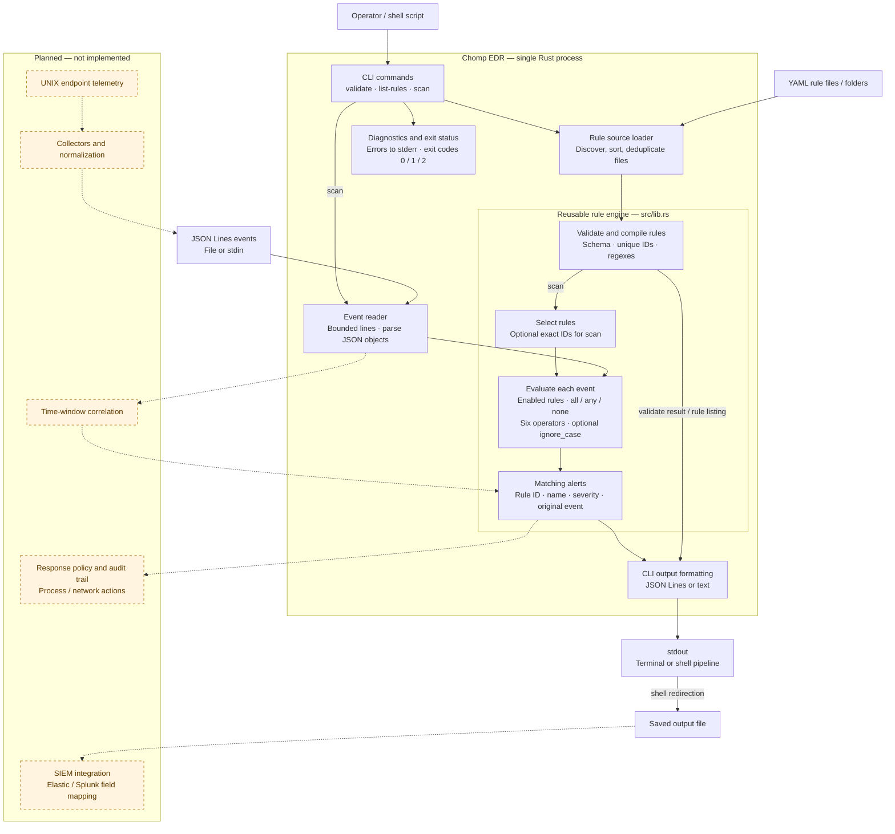

# Chomp EDR software architecture

The diagram below records the original October 1, 2026 CLI architecture at commit `79a7655`. For the current Linux response service, see [responses and approvals](responses.md).

For the presentation, use the [deployment and component diagram with slide copy](architecture-slide.md). It shows the endpoint and process boundaries, user interaction, local files, and third-party library dependencies. The diagram below provides a more detailed execution view and proposed extensions.

Solid arrows show implemented data flow. Dashed arrows and orange boxes show proposed extensions. The current CLI and library run together in one process; the boxes below are logical components, not separate services.

## Component responsibilities

| Component | Implementation | Responsibility |
| --- | --- | --- |
| CLI and I/O | `src/main.rs` | Parse arguments with Clap; load rule sources; stream events; format output; handle errors and exit codes |
| Rule preparation | `Engine::from_yaml`, `Engine::combine`, `Engine::select` | Validate all loaded rules, compile patterns, reject duplicate IDs across files, and optionally select exact IDs |
| Detection | `Engine::evaluate`, `CompiledCondition::matches` | Evaluate independent events against enabled rules; require positive conditions and apply exclusions |
| Alert model | `Alert` | Return rule metadata and the original event for every matching rule |
| Configuration | `rules/*.yaml` | Define rule metadata and conditions outside the executable |
| Verification | `tests/engine.rs`, `tests/cli.rs`, `.github/workflows/ci.yml` | Check library and CLI behavior on Linux, macOS, and Windows |

## Execution and boundaries

1. Every command loads and validates all supplied rule files before producing results. Regexes compile once during loading. `validate` and `list-rules` stop after reporting configuration results.
2. `scan` optionally selects exact rule IDs, then reads one JSON object per nonblank input line. Unknown IDs and invalid rules fail before event processing.
3. The engine evaluates each event independently. All required `all` conditions, at least one nonempty `any` condition, and no matching `none` exclusions must hold. Disabled rules never emit alerts.
4. Scan output contains alerts only; diagnostics go to stderr. Exit code 1 indicates alerts only when `--fail-on-alert` is requested; code 2 indicates an error. Output is flushed after each processed event.
5. The CLI limits each rule file and event line to 1 MiB. The library performs no file I/O and expects its caller to enforce input-size limits.

Since the original diagram, Linux collectors, time-window correlation, a dashboard with authenticated response approvals, and a separate response service have been implemented. Installed collectors write alerts to journald. The response service consumes those records into a private SQLite queue, applies each response mode, and executes supported actions after target verification. Operators approve or reject pending requests through `chompedr responses` or the web dashboard; standalone scans continue to emit alerts without executing responses. The diagram above is historical and does not show these service boundaries.
